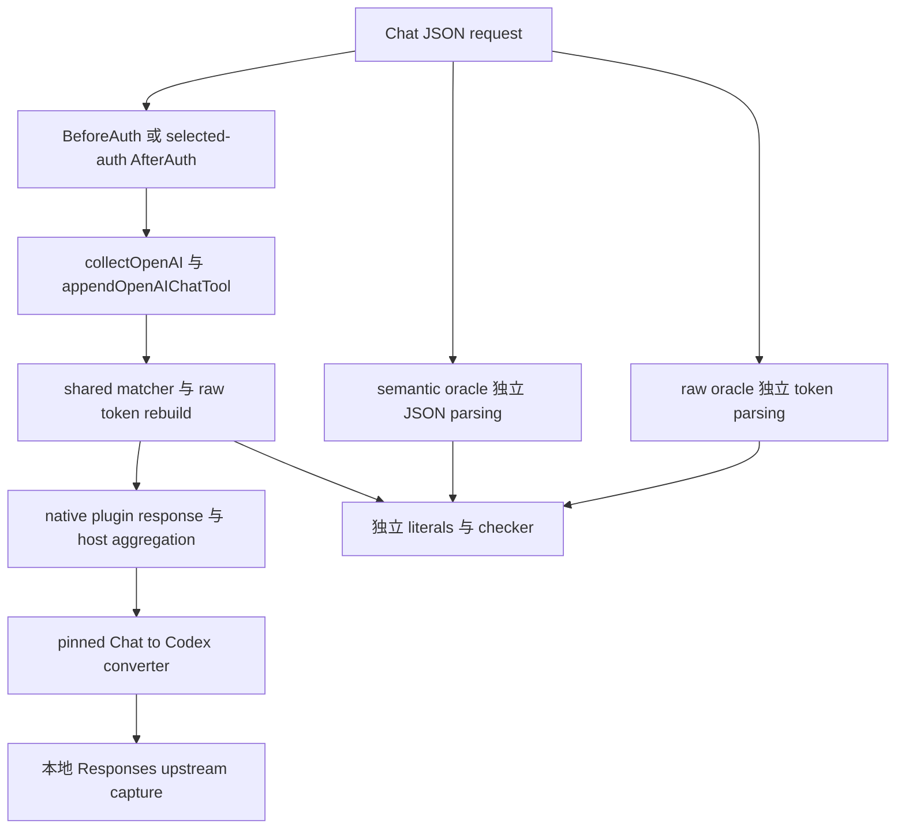
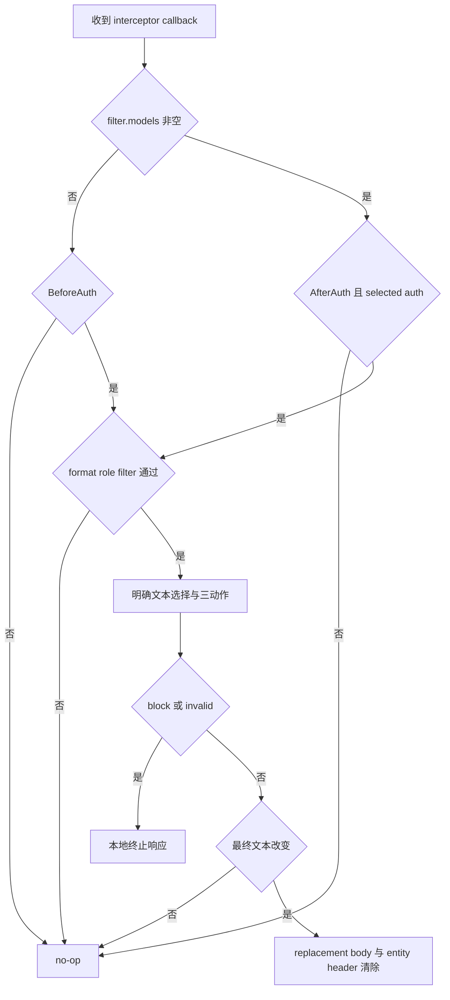
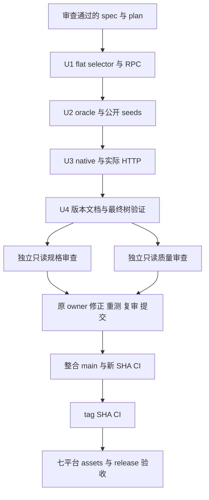

# v0.3.10 功能修正 - Plan

## Goal Capsule

**Goal：** 用户的正常 Chat flat custom tool description 在真实 Chat->Codex 请求中正确执行已有审查规则；协议测试正确接受已支持的 definitions 和 Claude title 超限拒绝，并完成 v0.3.10 的新提交验收与发布。

**Architecture：** 保持明确 provider selectors、共享 matcher 和原始 JSON token 重建。生产只补 `appendOpenAIChatTool` 的 flat custom 路径；两套 oracle 各自解析，测试修正不接入生产判断。

**Tech Stack：** Go 1.26、CGO native ABI v1、`encoding/json`、`unicode/utf8`、`gjson v1.18.0`、`CLIProxyAPI/v7 v7.2.152`、Go fuzz、GitHub Actions。

**Spec：** `docs/superpowers/specs/2026-10-11-v0310-functional-corrections-design.md` 是行为和兼容性依据。R1..R10 均指该 spec 的稳定要求编号；本 plan 只规定实施顺序和验证方法。

**Owner：** 一个独立 worktree 的实现 owner 连续完成 U1..U4，负责测试、自审、独立审查后的修正、复审及提交。发布 owner 在已完成 commits 无冲突后负责 U5 的 main 整合和实际远端验收。当前文档阶段只交付 spec/plan，不启动实现、不 push、不改 main、不创建 PR。

**Stop conditions：** 权限拒绝不绕过；所需工具不可用、真实测试失败、审查有未解决问题或 CI/资产未通过时，准确报告该项未完成。范围外新事实先回报并更新获授权的计划，不扩大生产路径或放宽 oracle 断言。不得修改权限、CLAUDE 或 Git metadata。

---

## Product Contract

### Summary

本轮修复一个生产漏选，并修正两项已复现的测试断言错误。新路径进入既有 developer scope 和三动作处理；公开测试保留独立 expected literals、独立 parsing 和 raw bytes 断言。真实注册和 HTTP 使用 pinned CPA 与本地 upstream，不调用商业 provider API。

### Problem Frame

基线 custom 分支只读 nested `custom.description`，而 pinned Chat->Codex converter passthrough 顶层 description。Claude/Gemini definitions 已在生产选择，但两套 oracle 缺少相应入口；Claude title 最终超过 500 时生产拒绝正确，checker 尚只接受 empty-strip 拒绝。代码修复不能把后两项改成新的生产行为。

### Requirements

| 要求 | spec 依据 | 实施与验收 |
|---|---|---|
| flat custom 类型/name/description gate，nested 独立保留 | R1 | U1、U2、U3 |
| 三动作、raw token 和 machine bytes | R2 | U1、U2、U3 |
| 两阶段、role/format/filter/selected-auth gates、RPC/host 区别 | R3 | U1、U3 |
| 两套 Chat oracle 与 excluded-token caller 同步 | R4 | U2 |
| Claude/Gemini definitions oracle，仅测试修正 | R5 | U2 |
| Claude changed title 最终 code points 与 forged-result 拒绝 | R6 | U2 |
| 公开 seeds、六项有界 fuzz、已有确定性 role 回归 | R7 | U2、U4 |
| native registration 和真实 Chat->Codex HTTP | R8 | U3、U4 |
| 必要 README/release notes 与版本文档 TDD | R9 | U4 |
| 最终树、完整独立审查、新 main/tag CI、七平台资产来源 | R10 | U4、U5 |

### Scope Boundaries

基线为 `2bbe8bbf75934437efd6ff2d570523ef9e0d830d`；固定 host commit `c76dfd4e0edabab9000628b1560ab8ab379eadb8`、dependency pin、schema 5 和 ABI v1。不修改 CPA、配置/panel、matcher、shared transform、其他 production selector、schema whitelist、生成 artifacts 或既有历史 spec/plan。

不增加通用 walker、parser、dependency、配置、额外 fallback 或性能优化。保留当前 fuzz generator 的默认角色与输入边界，assistant/tool 和 Responses instructions developer fallback 用既有确定性回归检查。商业 API acceptance、七平台全部 native 实际加载不属于本地测试结论。

---

## Planning Contract

### Key Technical Decisions

- KTD1. 在 shared `appendOpenAIChatTool` custom 分支增加最小 flat description 选择，复用 `appendStringSpan`；直接 caller `collectOpenAI` 无需独立实现。依据 R1..R3，nested 路径不加 flat name gate。
- KTD2. semantic/raw oracle 分别复用各自字段、schema helper，expected literals 单独给出。依据 R4..R6，生产选择器不成为 oracle 数据来源。
- KTD3. title checker 只增加当前默认角色覆盖中的准确 changed-title 最终长度判定。依据 R6、R7，不扩大生成器、角色或生产 validation。
- KTD4. 复用已有 RPC/native/Codex direct HTTP harness。依据 R8，生产 raw bytes 和 CPA 转换后的 consumer 输出分层断言，避免将 passthrough fixture 当作 Chat->Codex 证明。
- KTD5. 所有写入任务在一个实现 worktree 连续完成，避免 `fuzz_test.go`、`functional_corrections_test.go` 和 `integration/http_test.go` 的重叠 owner。独立只读规格与质量审查并行；实现 owner 负责全部修正。
- KTD6. 使用现有 Makefile VERSION 和 build.yml，不新增发行机制。依据 R9、R10，源码输入、VCS metadata、ABI version 和资产 hashes 分别核查。

### High-Level Technical Design

生产和验证的数据流保持分层：



阶段与 gate 依据 R3，no-op 必须保持原请求，模型筛选不能从其他字段补值：



执行和发布依赖如下。只读 review 不与实现 owner 争用可写文件或 `.integration/run`：



### File Ownership and Prerequisites

| 文件 | 需要核查的调用或测试位置 | owner |
|---|---|---|
| `selectors_openai.go` | `appendOpenAIChatTool`、唯一直接 caller `collectOpenAI` | 实现 owner，U1 |
| `selectors_openai_test.go` | Chat definitions、raw replacements、canonical roles、Responses instructions/fallback 回归 | 实现 owner，U1 |
| `functional_corrections_test.go` | `functionalRequest`、`functionalCall`、rewrite/block helpers、两阶段/bypass matrix | 实现 owner，U1 |
| `fuzz_test.go` | 两套 Chat/Claude/Gemini helper、`oracleExcludedTokens`、`checkProtocolResult`、public seeds | 同一实现 owner，U2 |
| `integration/http_test.go` | fixture sets、`TestHTTPFunctionalNativeRegistrationAndPhases`、direct Codex HTTP helpers | 同一实现 owner，U3 |
| `README.md`、`RELEASE_NOTES.md`、`main_test.go` | 字段说明与 `TestReleaseNotesCompatibilityTargetsCurrentAndHistoricalVersions` | 同一实现 owner，U4 |

`integration/harness_test.go`、`.github/scripts/integration-runner.go`、ABI testdata、Makefile 和 build.yml 是已存在的复用/核查来源，当前设计不要求修改。启动时记录 worktree BASE、branch、HEAD、clean/已有改动和 Go/CGO 环境；只保护、保留已有改动，不使用共享 stash，不删除其他 worktree。初始 `make test` 和已有 deterministic oracle/role tests 记录基线；已有输入通过不能否定新增 fixtures 的已复现错误。

普通任务使用可用 Sonnet[1m]/xhigh；最困难的必要审查最多使用 Opus[1m]/xhigh，不用 Fable/max。实现 owner 的 `.integration/run` 和 build/package 输出串行使用；可以并行的独立只读审查必须并行。后台任务要求完成后主动通知，等待时不 sleep、不监视文件、不反复读取状态或输出。

---

## Implementation Units

### U1. Chat flat custom selector 与 RPC

**Goal：** 使 R1..R3 进入实际 shared selector 和两阶段 RPC。

**Dependencies：** spec/plan 文档审查完成，独立实现 worktree 已创建并记录 BASE。

**Files：** `selectors_openai.go`、`selectors_openai_test.go`、`functional_corrections_test.go`。

**Approach：**

1. grep `appendOpenAIChatTool` 的全部 caller，并核对 pinned consumer 的 custom passthrough；只读取相关 converter，不修改 dependency。沿用 definitions tests 和 `replaceRawTokens` 的精确 expected bytes。
2. 添加正常 flat 最小输入的 selector/transform/RPC focused tests，分别要求 block 的 `SECRET/developer`、strip ` tail`、obfs 中实际 U+200B。生产未改时实际运行并保存预期漏选断言 RED，编译错误或没有匹配测试不能算 RED。
3. 在 custom 分支按 KTD1 增加 flat gate 与 `appendStringSpan`，保留 nested 逻辑；运行同一测试取得 GREEN，再补边界和 R3 阶段矩阵。
4. 自审必要修改、运行相关回归、检查 diff；只提交本单元相关文件。同一 owner 继续 U2，完整 worktree 独立审查在 U4 完成后覆盖所有 commits。

**Test scenarios：**

- default developer 和 developer-only；developer disabled、format disabled、filter miss 均 no-op。
- flat name 缺失/空/null/数字，description 缺失/空/null/数字/Object，非 custom type 和非 Object tool；合格 nested 单独命中仍照原行为处理。
- nested-only、flat + missing/empty/null/safe custom、flat/nested 都命中、原始成员位置不同。grammar/name/ID/metadata 含 SECRET 保留。
- exact/folded、普通 Unicode、escaped/surrogate 后续文本、完整 strip、无命中、cascade、取消、no cross-node、rule-major 和最早 token canonical role。
- BeforeAuth 无 model filter、selected-auth AfterAuth 有 model filter；model-bearing BeforeAuth 在 parsing 前 bypass、model-free AfterAuth、unselected AfterAuth no-op。只取 request.Model 的 decoy 对照。
- RPC exact replacement/三项 ClearHeaders，本地 block code/term/role；无变化空原始插件响应。请求 body、metadata、headers 的前后 snapshot 相同。

**Verification：** 三动作新增 focused RED -> GREEN 有真实输出，全部 R1..R3 对照通过，已有 Chat nested/function/schema 和 Responses fallback、instructions、role 测试不变。无新增 production path 或 shared transform 改动，提交范围准确。

### U2. 两套 oracle 与已复现 checker 错报

**Goal：** 完成 R4..R7，生产正确结果和 forged results 得到准确判定。

**Dependencies：** U1。

**Files：** 仅 `fuzz_test.go`。

**Approach：**

1. 先添加独立 spans/roles/raw token literal assertions 和公开 flat/nested/mixed/gate/machine seeds，运行观察旧 Chat oracle 漏选的真实 RED；再分别同步 `oracleAppendOpenAIChatTool` 与 `oracleRawAppendOpenAIChatTool`，核对 semantic/raw direct callers 和 `oracleExcludedTokens`，取得 GREEN。不依赖生产输出生成 expected。
2. 添加 18 个已复现 definitions fixtures。每个先断言生产 block 正确，再要求 checker 接受，观察基线 oracle 的真实 RED；仅补 R5 指定四个 helper。分别复用各自 schema helper，取得 GREEN。
3. 添加 title 499 -> 500、500 -> 501 focused fixtures，先确认生产结果和 Invalid envelope，再观察 checker 的真实 RED。按 KTD3 添加独立 changed-final-title 判定，保持 empty-strip 分支，取得 GREEN。
4. 增补下列负向与 rewrite 检查，所有新 seeds 在普通 test 模式实际运行，再执行 Verification Contract 中六项 bounded fuzz。记录失败输入并判断根因，修复范围内问题后重跑；自审、回归、提交本文件。

**Test scenarios：**

- Chat 两套 oracle 的 flat 类型/name gate，nested 独立选择，full strip、machine-only、mixed 顺序和 escaped raw ranges。`oracleExcludedTokens` 不漏保留字段或错误覆盖整个 mixed tool。
- Claude 四个入口：tools.description、input_schema property description、output_config.format.schema、output_format.schema。string name/Object input_schema gate、system role 和 invalid shapes 对照。
- Gemini 两种 declarations key，各七个 description/schema fixture；六 schema 独立读取、developer role、invalid declaration 对照。两 key 同时存在和不同 token 位置不改变最早 role 判断。
- definitions 的 block/strip/obfs × fold false/true、safe messages、空/非字符串 descriptions、根/合法 nested schema、unknown keyword、enum/default/const/required/keys machine values。
- title 最终 500 接受、501 拒绝；中文、emoji、escaped Unicode；strip 后仍超限或降至合法长度。结果依据解码后的 Unicode code points。
- forged Invalid：未命中/unchanged 超长 title、其他字段超长、search_result、其他 format、assistant/tool 默认关闭、modeBlock、错误 message、非空 Body、非 nil Blocked。保留其他格式的 signature/annotation/dormant/empty-strip 既有断言。
- 保留默认 system/developer/user 生成器，运行既有 assistant/tool 排除、canonical roles 和 Responses instructions developer fallback 的确定性回归。

**Verification：** 新 focused tests 分别区分正确 production 与错误 checker，有 definitions/title 的断言 RED 和 GREEN；公开 fixtures 永久存在，不依赖临时 seed 编号。两套 parser 不合并，不调用生产 selector，raw bytes 和 forged-result 拒绝保持。六项有界 fuzz 全部实际完成并记录结果，提交仅测试文件。

### U3. 真实 native 注册与 Chat->Codex HTTP

**Goal：** 按 R8 验证实际 dynamic library 与 pinned consumer。

**Dependencies：** U1、U2。

**Files：** `integration/http_test.go`；复用 `integration/harness_test.go` 和 ABI testdata，不修改其生产实现。

**Approach：**

1. 增加 flat custom fixture，加入 `TestHTTPFunctionalNativeRegistrationAndPhases` 的 fixture 集合；复用 `withDynamicABIHost`，保留实际注册、配置和现有 fixture matrix。
2. 新增 focused Chat flat custom->Codex HTTP test，复用 direct provider harness，provider 为 codex，入口 `/v1/chat/completions`，upstream 捕获 `/responses`。复用 fixture 可覆盖的 actions，额外补 default scope、developer disabled 和无命中对照。
3. 实际运行 focused native/HTTP 和完整 `make integration`。本单元是 U1 已证明行为的 test-only integration 补充，不伪造新的生产 RED；生产 TDD 证据来自 U1，实际动态库和 HTTP consumer GREEN 由本单元取得。
4. 核对日志、upstream 捕获和原始 request snapshots，自审并提交本文件；不创建另一个 mock selector 或 generic passthrough consumer。

**Test scenarios：**

- register/config/intercept 经实际 DLL 或 .so；metadata、ConfigFields、ABI/capabilities 保持。integration version 为 0.0.0-dev。
- native BeforeAuth/selected-auth AfterAuth 三动作及取消；原始 RPC 与 host 聚合的 Body/Headers/Terminate 分别按 R3 断言。
- HTTP block 为 400/JSON、code censorship_blocked、term SECRET、role developer；upstream.arrivalCount 为零。
- HTTP strip/obfs 到达且成功读取恰好一次，Responses tools[].description 为独立 expected literal，短 name、grammar 和转换后应保留的 machine fields 正确。
- native/RPC 证明 format、model/auth/role gate；HTTP default developer、developer disabled、filter bypass、无命中和取消的 consumer 文本正确。
- HTTP fixture 的 CPA 改写结构与插件 raw token 保留分层检查，不比较原 Chat body 与转换后整个 Responses body 的 bytes。

**Verification：** focused 实际 native 和 Codex consumer tests 与完整 integration 全通过；CPA binary revision 通过 harness 的 pin 检查。arrival 和 request 两计数均核对；没有商业 API 调用，没有手改 `.integration/`，没有并行覆盖 runner 输出。

### U4. 版本文档、独立审查与最终树验收

**Goal：** 完成 R9、R10 的实现树和本地产物验收。

**Dependencies：** U1..U3。

**Files：** `README.md`、`RELEASE_NOTES.md`、`main_test.go` 的当前版本兼容测试；必要修正仅限 U1..U3 已授权文件。

**Approach：**

1. 将 `TestReleaseNotesCompatibilityTargetsCurrentAndHistoricalVersions` 的当前 header、section boundary、compatibility 预期改成 v0.3.10，保留 v0.3.9 及全部更早历史断言。运行观察旧文档的真实 RED，然后修改 README 必要字段描述和 release notes，取得 GREEN。发行日期用实际日期，未通过 CI 不写成已通过。
2. 版本文档 GREEN 后运行全量 Verification Contract，构建和打包用现有 VERSION 注入；本地 ZIP、sidecar、库平台、hash、build info 与 ABI metadata 分别核对。
3. 自审后提交相关文档/测试，只读规格审查与质量审查并行检查完整 `BASE..HEAD`。规格 reviewer 逐项核对 R1..R10 的本地完成范围和仍属 U5 的远端条件；质量 reviewer 检查实现/oracle 独立性、TDD、bytes、阶段和复用质量。
4. 实现 owner 在原 worktree 修正所有已核实问题，运行相关和全量回归、新建提交、复审至无未解决问题；不得将审查/修正留给主会话。
5. 在最后一个提交的准确 HEAD 上执行无缓存 test、race、vet、六项 bounded fuzz、integration、正式 build/package 和 native ABI smoke。记录准确 SHA 和产物来源证据，确认 clean tree，仅移除本次无需保留的临时文件，不删除用户文件。

**Test scenarios：** 版本 header/历史 boundaries、pinned dependency/schema/ABI/glibc 兼容句；正式 VERSION 注入 0.3.10 与 integration dev version 分开；最终树无遗漏 seed、超范围 diff、未提交修正或旧库使用。

**Verification：** U1..U4 各项 TDD/回归有实际结果，独立规格/质量审查无未修正问题，提交后最终 HEAD 的本地 full checks 和正式产物已核对。只交付完整 commits、实际 BASE..HEAD、测试/审查记录、产物 hashes 和尚需 U5 完成的明确条件，不宣称 release 已完成。

### U5. main、tag CI 与七平台公开资产

**Goal：** 完成 R10 的新 SHA 远端验收和 v0.3.10 发布。

**Dependencies：** U4 完成，所有工作树任务已提交并审查通过；当前发布授权仍有效。

**Files：** 不新增源码；操作已完成 commits、Git refs、现有 build.yml runs 和 release assets。

**Approach：**

1. 发布 owner 检查 commit 来源、文件无冲突、已有改动受保护，再合并本地 main，记录真实 main SHA。只用新 SHA 的结果，必要本地合并树检查完成后推送。
2. 对该 main SHA 启动一次 CI watch，使用完成主动通知。检查 test、全部七平台构建和下述实际执行 steps，不能用历史成功、skipped 或 pending 代替。下载该次 main CI 的七个平台 ZIP/sidecar，核对 dev 版本、库平台、hash、dependency pins、`vcs.revision` 等于 main SHA 和 `vcs.modified=false`；缺失或不同阻止创建 tag。
3. main 全通过后检查既有 tag/release，按现有机制创建并推送 v0.3.10。核对 tag 指向和对应新 Build 的 test、七平台 build、release，等待完成通知；不重复创建或覆盖公开资产。
4. 下载七 ZIP、七 sidecars 和 checksums.txt 到系统临时机制创建的各自新目录；解释器脚本与下载目录分开，Python 用 `-I`。按资产检查表验收，用可靠 ZIP parser 和 build info 工具，不从下载目录运行脚本或 build tools。
5. 真实失败交原实现 owner 在原 worktree 修正、重测、复审、新提交；按新 main/tag SHA 重新核查。发布 ref 或已公开资产涉及修改时按实际授权处理，不 force-push 或擅自覆盖。

**Verification：** main SHA CI、tag SHA CI、七平台精确资产和非 draft release 全部通过；缺失、错误或未实际执行项目保持未完成。最终报告包含实际 main/tag/CI/release 标识及各资产 checksums，不使用旧版本或本地 dev 库作为替代证据。

---

## Verification Contract

所有命令在负责的 worktree 根执行，执行工具需要路径时使用该 worktree 的绝对路径。以下 focused 测试名为计划新增名称，实现时保持可识别名称或同步命令；运行输出必须确认确实执行了目标测试，不把 `no tests to run` 计为通过。

| 范围 | 命令或操作 | 通过依据 |
|---|---|---|
| flat selector/RPC | `go test -run '^(TestOpenAIChatFlatCustomDescription|TestFunctionalFlatCustomDescription)' -count=1 -v .` | 新三动作、gate、bytes 和阶段断言实际执行 |
| oracle focused | `go test -run '^TestProtocolOracle' -count=1 -v .` | 新 definitions/title/flat 和既有 forged-result tests 都通过 |
| 公开 protocol seeds | `go test -run '^FuzzProtocolTransform$' -count=1 -v .` | 所有已有和新增公开 seed 实际执行，无临时编号依赖 |
| role/兼容回归 | `go test -run '^TestOpenAI' -count=1 -v .` | default-disabled、canonical、instructions、nested fallback 等保持 |
| 版本文档 | `go test -run '^TestReleaseNotesCompatibilityTargetsCurrentAndHistoricalVersions$' -count=1 -v .` | 文档真实 RED -> GREEN，全部历史兼容保持 |
| 最终 root suite | `go test -count=1 ./...`、`go test -race -count=1 ./...`、`make test`、`make race`、`make vet` | 准确最终 HEAD 上实际成功，不能借缓存代替 |
| Windows packager | `go test .github/scripts/package-release.go .github/scripts/package-release_windows.go .github/scripts/package-release_test.go .github/scripts/package-release_windows_test.go -race -count=1`，同四文件 `go vet` | 根 ./... 不覆盖该目录，完整 file-list 单独通过 |
| Unix packager | `go test .github/scripts/package-release.go .github/scripts/package-release_other.go .github/scripts/package-release_test.go -race -count=1`，同三文件 `go vet` | 现有 Ubuntu CI 在新 main/tag SHA 实际执行 |
| registered/HTTP/full integration | `make integration` | 含 runner 自身 tests、native 注册/阶段、focused Chat->Codex 和全部既有集成 |
| 正式 host build | `make build VERSION=v0.3.10` | CGO 正确，library metadata 为 0.3.10 |
| 正式 host package | `make package-platform GOOS=windows GOARCH=amd64 VERSION=v0.3.10`（本机目标），随后 `make package VERSION=v0.3.10` | 使用现有 host-helper recipe、真实 ZIP/sidecar/aggregate 检查 |
| 正式库 ABI smoke | 现有 runner 的 `-abi-smoke`，传入本次正式 host library 的绝对路径 | 实际 active-after callback，保留源码/hash/metadata 证据；不强套 dev-only registration 断言 |
| diff 与审查 | `git diff --check`、完整 task `BASE..HEAD` 的独立规格/质量审查 | 无超范围改动、未解决 findings 或未提交修正 |

六项 bounded fuzz 串行执行，每项预算 30s，`-parallel=1`，目标 package 为 `.`。最终提交后重复同一组命令并记录准确 HEAD；预算指 fuzz 阶段，完整实际耗时另行记录。

```bash
go test -run '^$' -fuzz '^FuzzRuleEngineAgainstOracle$' -fuzztime=30s -parallel=1 .
go test -run '^$' -fuzz '^FuzzFoldKMPAgainstOracle$' -fuzztime=30s -parallel=1 .
go test -run '^$' -fuzz '^FuzzDuplicateWalkerAgainstOracle$' -fuzztime=30s -parallel=1 .
go test -run '^$' -fuzz '^FuzzProtocolTransform$' -fuzztime=30s -parallel=1 .
go test -run '^$' -fuzz '^FuzzRebuildBodyAgainstMarshalOracle$' -fuzztime=30s -parallel=1 .
go test -run '^$' -fuzz '^FuzzByteMatcherAgainstOrderedContains$' -fuzztime=30s -parallel=1 .
```

失败时保留实际 failing input、target、命令和错误，确认是否在本轮范围。范围内修正采用 focused reproduction、原 worktree 修复、回归、独立复审；范围外问题回报协调者决定，不删失败、不降低断言、不把超时或 skip 当作 PASS。临时诊断使用系统临时文件，永久已确认回归放入现有测试/seeds，清除本次不再需要的诊断文件。

main 和 tag CI 均须检查现有 build.yml 的 Ubuntu root test/race/vet/integration/.so、packager 独立 file-list race/vet，Windows amd64 packager regression 和 `Verify Windows amd64 active-after ABI`，五个 native matrix targets 加 windows-arm64、freebsd-amd64 构建均成功。发布 job 只在 tag 跑；main 没有 release job 属于现有机制，不能把不存在的 main release 状态列为失败或通过。

### Artifact Acceptance

下表文件集合用于 tag/release。main CI 七平台 artifacts 使用 `0.0.0-dev` 文件名与注入版本，并核对对应 main SHA；不与 tag 资产混用。

| 检查对象 | 要求 |
|---|---|
| 平台集合 | linux/amd64、linux/arm64、darwin/amd64、darwin/arm64、windows/amd64、windows/arm64、freebsd/amd64，恰好七项 |
| 文件集合 | 每项 `censorship_0.3.10_<goos>_<goarch>.zip`、对应 `.zip.sha256`，另 checksums.txt；不混入 dev/旧版本 |
| ZIP/sidecar | ZIP integrity/CRC、预期 library 与仓库 LICENSE；现有 packager 不把 README/release notes 放入 ZIP。小写 SHA-256 sidecar 指向正确 basename，hash 匹配实际 bytes |
| aggregate | checksums.txt 恰有七条正确记录，无缺失、重复或多余 entry |
| 动态库 | ELF/PE/Mach-O 平台/架构正确，Go build info 的 dependency pins 与预期相符 |
| 版本与来源 | main artifacts 保持 dev metadata，tag assets 注入 0.3.10；每库 vcs.revision 为对应真实 main/tag SHA，vcs.modified=false |
| 公开状态 | tag/release 指向正确 SHA、非 draft；下载 bytes 与 workflow 验证的资产相同，不覆盖已公开 assets |

`docs/solutions/workflow-issues/go-worktree-build-provenance.md` 要求 source inputs、VCS metadata 和 ABI injection 分别验证。实现 owner 保留 HEAD/blobs、构建工作目录/inputs、toolchain、artifact hash 和真实注册 metadata；nested linked worktree 的 revision 疑点不能凭版本字符串消除。最终 main/tag 七库缺失或错误 revision 是未通过条件。使用可靠 build-info reader 和文件格式工具；若无法读取注入版本，记录未核实项并补齐工具核查，不能将文件名版本当作注入版本证明。

---

## Definition of Done

U1..U4 本地完成须同时满足：

- production diff 仅新增符合 R1 的 Chat flat description；两项 fuzz 错报均标为测试断言修正，正确生产代码不改。
- definitions 和 title 的永久复现测试有真实断言 RED -> GREEN；独立 semantic/raw parsing、expected literals、raw token 和机器字段 bytes 断言保持。
- RPC、真实 native 和实际 Chat->Codex HTTP 都通过，阶段 gate、header/no-op/取消语义不变。
- 全部公开 seeds、六项 bounded fuzz、full/race/vet、本机平台 packager 独立 checks、build/package/integration/正式 ABI smoke 在最终提交 HEAD 完成。Unix packager 和 Linux 实际 integration 由 U5 的新 CI 验收，不将本地未运行项计为通过。
- README/release notes 只记录当前真实完成内容和兼容范围；历史保留，版本由既有 VERSION 注入。
- 完整 BASE..HEAD 的独立规格/质量审查无未修正问题，所有修正重测、复审和提交由原 owner 完成，工作树 clean，实验残留清除且用户已有文件保留。

整项 release 完成还须 U5 的真实 main SHA CI、tag SHA CI、七平台 ZIP/sidecar/aggregate、build provenance 和非 draft 公开状态全部通过。未执行商业 provider API 或其他平台 native 加载只如实声明覆盖限制，不写为已验证。
